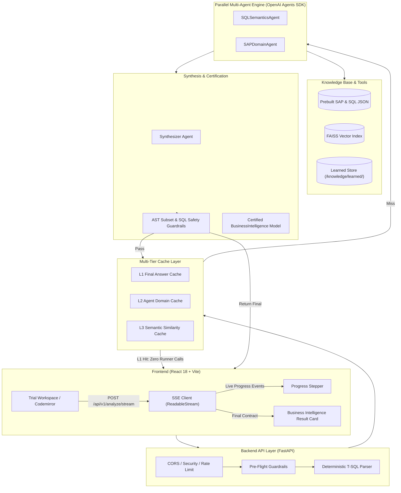

# Syniti Migrate MDM & DQ Analysis Engine

An enterprise-grade, multi-agent AI pipeline designed to analyze Microsoft SQL Server (T-SQL) data migration queries, resolve SAP domain semantics, and synthesize certified Data Governance catalog rules.

---

## 1. System Architecture



---

## 2. Key Architectural Principles

1. **Strictly No Offline / Demo Mode:** Production code never ships demo, mock, offline, or canned analysis data. Every analysis result comes from the real backend orchestrator communicating with the configured LLM. If the LLM is unconfigured, requests fail fast with `LLM_NOT_CONFIGURED`.
2. **Two Concurrent Domain Agents:** Analysis is split between specialized domain agents (`SQLSemanticsAgent` and `SAPDomainAgent`) that execute in parallel via `asyncio.gather`. Total agent latency is `~ max(t_sql, t_sap)` rather than the sum.
3. **Multi-Tier Cache Coordination:**
   - **L1 Final Cache:** Completely bypasses the agent pipeline on identical repeats (zero runner calls).
   - **L2 Agent Cache:** Caches SQL semantics and SAP domain analysis independently.
   - **L3 Semantic Similarity Cache:** Reuses cached agent outputs when query structure matches at $\ge 0.97$ cosine similarity.
   - **Cache Key Model Isolation:** Cache keys incorporate both the model identifier and a hash of the base URL, guaranteeing switching models never serves cross-model cached data.
4. **Error Query Subset Invariant:** The generated `error_query` is mathematically verified via AST traversal to be a strict subset of the `opportunity_query` (matching driving tables, join conditions, and scope predicates).

---

## 3. Quickstart & Setup (Windows PowerShell)

> [!NOTE]
> **Zero API Key Needed for Tests:** All automated unit tests, contract checks, and frontend suites execute 100% offline using deterministic test doubles and fixtures. An API key is only needed for live production inference or the live evaluation harness.

### Step 1: Clone & Configure Python Virtual Environment
```powershell
# Navigate to repository root
cd D:\MDM_Syniti

# Create and activate Python 3.10+ virtual environment
python -m venv .venv
.\.venv\Scripts\Activate.ps1

# Install backend dependencies
pip install -r backend/requirements.txt
```

### Step 2: Configure Environment (`.env`)
```powershell
# Create root .env file:
Set-Content -Path ".env" -Value 'OPENAI_API_KEY=sk-proj-yourActualKeyHere
LLM_MODEL=gpt-4o-mini
STRUCTURED_OUTPUT_MODE=native
LLM_API_MODE=responses'
```

---

## 4. Running the Application

### 1. Backend Server (FastAPI + Uvicorn)
```powershell
# Start ASGI server on http://127.0.0.1:8000
.\.venv\Scripts\python -m app.api.run
```
- Interactive Swagger UI: [http://127.0.0.1:8000/docs](http://127.0.0.1:8000/docs)
- Liveness Probe: `Invoke-RestMethod http://127.0.0.1:8000/health`
- Readiness Probe: `Invoke-RestMethod http://127.0.0.1:8000/ready`
- LLM Status Endpoint: `Invoke-RestMethod http://127.0.0.1:8000/api/v1/llm/status`

### 2. Frontend Development Server (React + Vite)
```powershell
cd frontend
npm install
npm run dev
```
Open your browser at [http://localhost:5173](http://localhost:5173). The Vite dev proxy automatically routes `/api`, `/health`, and `/ready` to `http://127.0.0.1:8000`.

---

## 5. Automated Test Execution

### Backend Tests (pytest)
```powershell
# Run all offline unit, contract, and behavior tests:
.\.venv\Scripts\python -m pytest backend/tests

# Run dedicated traceability behavior verification (the 6 Phase 7A guarantees):
.\.venv\Scripts\python -m pytest backend/tests/test_traceability_behaviors.py
```

### Frontend Tests (vitest & RTL)
```powershell
cd frontend
npm test
```

### Linting & Type Safety
```powershell
# Backend lint and typecheck
.\.venv\Scripts\python -m ruff check backend scripts
.\.venv\Scripts\python -m mypy backend/app

# Frontend lint, formatting, and typecheck
cd frontend
npm run lint
npm run format:check
npm run typecheck
npm run build
```

---

## 6. Command-Line (CLI) Diagnostic Helpers

### 1. Environment & Key Status (`--check-env`)
Inspects active configuration, `.env` file discovery, and optionally pings OpenAI:
```powershell
python -m app.agents.cli --check-env
python -m app.agents.cli --check-env --ping
```

### 2. Model Switch Readiness Probe (`--check-model`)
Tests plain completion, native structured output (strict schema), tool calling, and JSON prompt fallback before switching to models like **Astra-Luna**:
```powershell
python -m app.agents.cli --check-model
```
See [docs/MODEL_SWITCH.md](docs/MODEL_SWITCH.md) for full details.

### 3. Prompt Prep & Context Inspection (`--inspect-inputs`)
Runs the parser and prompt preparation up to the LLM call without spending budget. Outputs section token counts, context window percentage, and unverified knowledge warnings:
```powershell
python -m app.orchestrator.cli --inspect-inputs --example sheet1
```

### 4. Live Evaluation Harness (`eval_live.py`)
Scores orchestrator performance against the original workbook dataset without string equality:
```powershell
python scripts/eval_live.py --sheets all --max-cost 5.0 --judge
```
Outputs comprehensive JSON and Markdown reports into `docs/eval/`.

---

## 7. Documentation Index

- [docs/TRACEABILITY.md](docs/TRACEABILITY.md) — Requirement traceability matrix and verification status.
- [docs/PROJECT_RULES.md](docs/PROJECT_RULES.md) — Architectural rules, typed errors, and failure policies.
- [docs/MODEL_SWITCH.md](docs/MODEL_SWITCH.md) — Transition guide for Astra-Luna and alternative inference endpoints.
- [docs/RUNBOOK.md](docs/RUNBOOK.md) — Operations runbook, error code handling, circuit breaker, and troubleshooting.
- [docs/GO_LIVE_CHECKLIST.md](docs/GO_LIVE_CHECKLIST.md) — Production deployment and sign-off checklist.
- [docs/KNOWN_LIMITS.md](docs/KNOWN_LIMITS.md) — T-SQL scope, length limits, and cache tier boundaries.
- [docs/LICENSES.md](docs/LICENSES.md) — Open-source license compatibility summary.
- [knowledge/REVIEW.md](knowledge/REVIEW.md) — Unverified knowledge items and verification governance.
